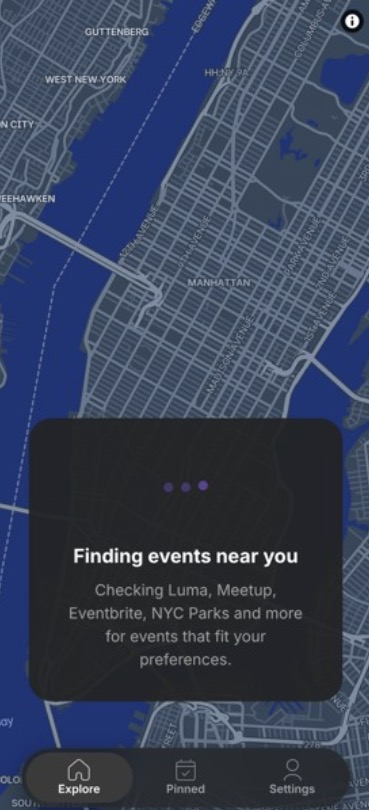
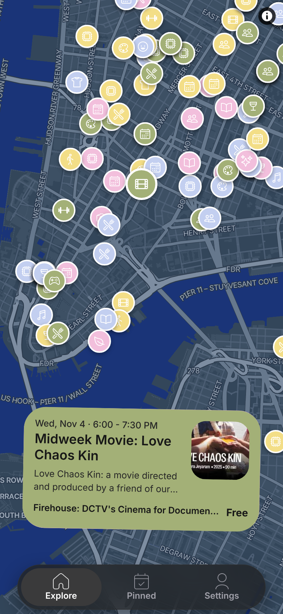
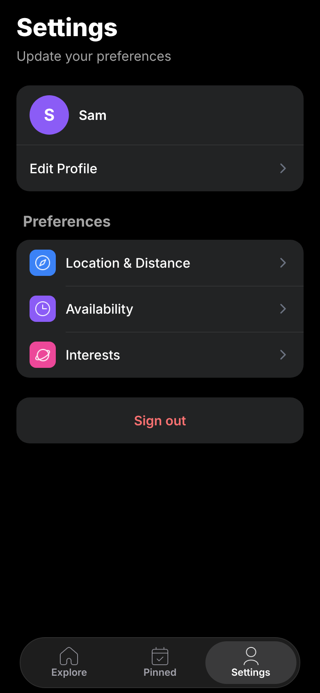
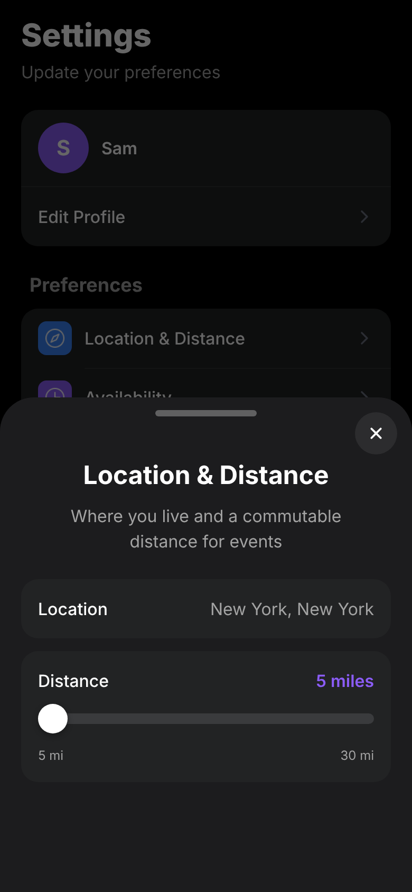
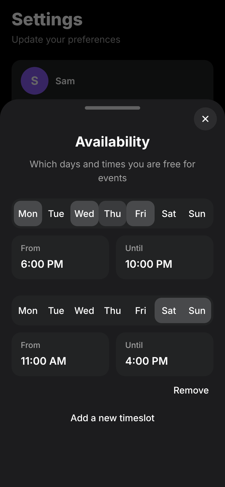
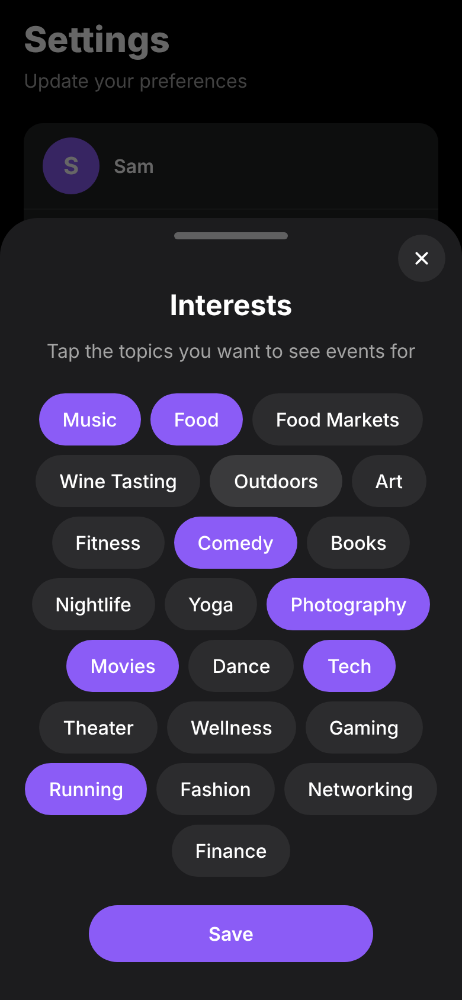

# City Scraper

Event exploration and management tool. Scrapes event-hosting websites like Luma, EventBrite, and Ticketmaster's public APIs to suggest events for users based on their inputted location, availability throughout the week, location, and range of commutable distance.

## Screenshots

Recommended events are displayed with their location on a map, with an event card containing basic information. Tapping on the card centralizes the user's view of the event on the map, and tapping again opens an expanded modal with more event information and a link to the external listing. Swiping left archives the event, swiping right saves it.

 

On signing in, users enter basic information and their preferences for events, they can return to their settings page to edit this information. Editing preferences will reload the recommendations, but keep pinned events safe.>

 

## Try it yourself

Download the Expo Go app and go to:

exp://u.expo.dev/6088bc15-e538-42e2-8b29-00149cb2aa9a/group/cb6ed6bd-fad6-47a0-abee-40727087a94f

